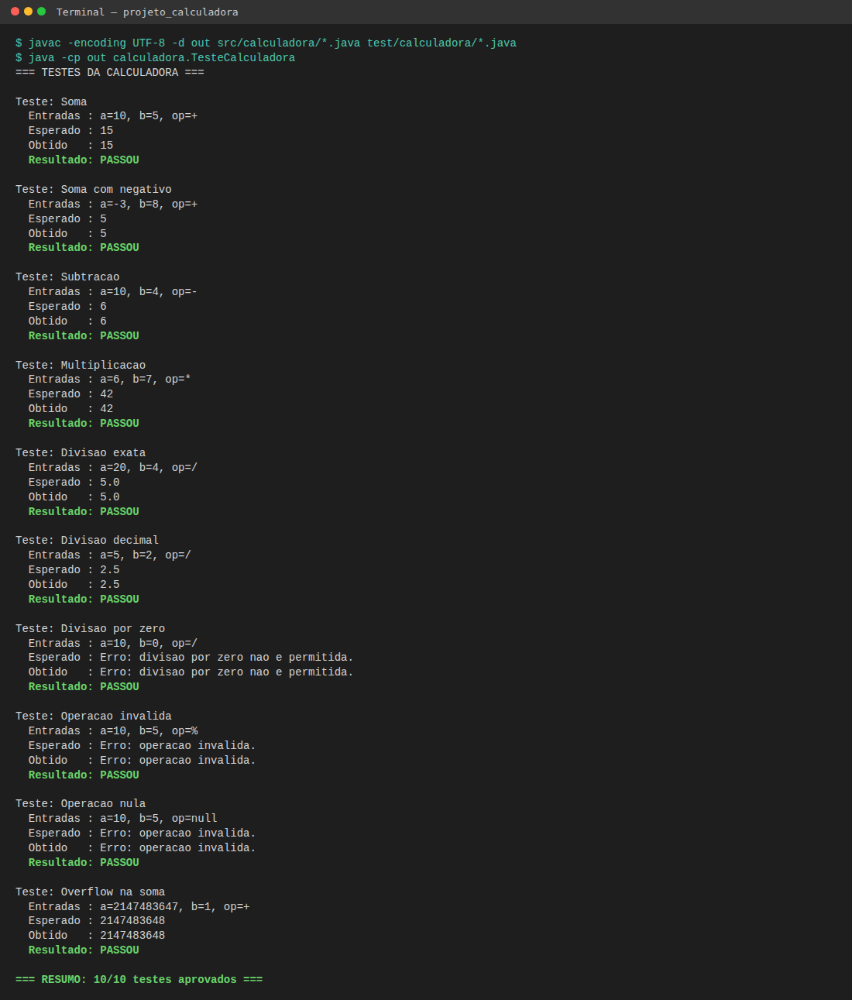
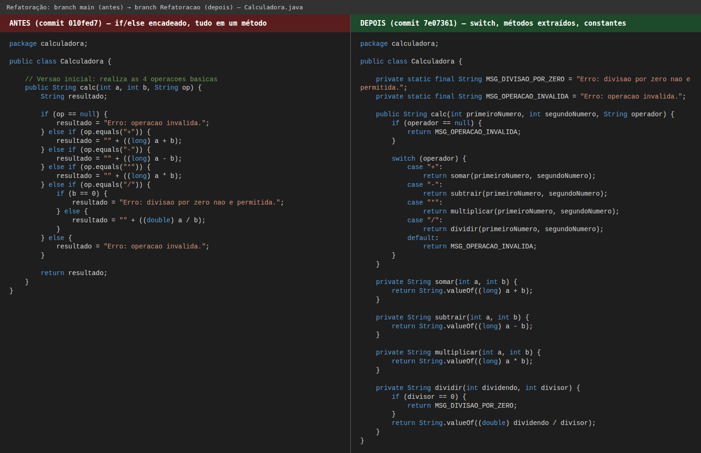
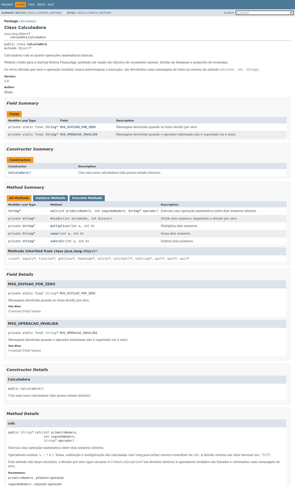
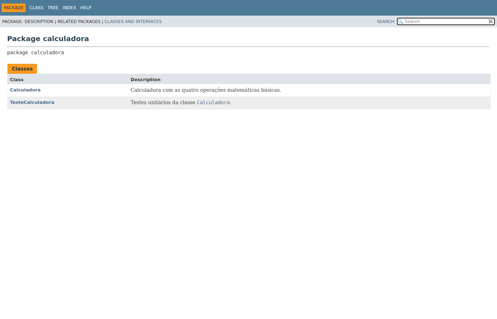

# Projeto Calculadora — FinançApp

> Projeto acadêmico desenvolvido com foco em Qualidade de Software, Testes, Refatoração, Documentação e Versionamento.

---

## 1. Identificação do Projeto

**Projeto:** Projeto Calculadora  
**Contexto:** FinançApp  
**Aluno:** Luan Gomes Marques  
**RA:** 251501  
**Curso:** Análise e Desenvolvimento de Sistemas  
**Disciplina:** NOME DA DISCIPLINA  
**Professor:** NOME DO PROFESSOR  
**Semestre:** 2026.2  

---

# 2. Visão Geral

O projeto consiste no desenvolvimento de um módulo de cálculos matemáticos básicos em Java para a startup fictícia **FinançApp**.

O módulo foi desenvolvido com o objetivo de ser utilizado futuramente em funcionalidades de controle financeiro, como:

- orçamento mensal;
- divisão de despesas;
- projeções financeiras;
- cálculos auxiliares.

Além do funcionamento correto das operações, o projeto aplica práticas de qualidade de software relacionadas a:

- testes;
- tratamento de erros;
- refatoração;
- documentação;
- versionamento;
- manutenção de código.

---

# 3. Problema

Durante o desenvolvimento da aplicação FinançApp, foi identificada a necessidade de criar um módulo matemático reutilizável.

Entretanto, a equipe definiu que o módulo não deveria apenas funcionar corretamente, mas também apresentar:

- código legível;
- testes automatizados;
- tratamento de falhas;
- documentação técnica;
- controle de versões;
- facilidade de manutenção.

O desafio consiste, portanto, em desenvolver uma solução funcional e ao mesmo tempo aplicar boas práticas de Engenharia de Software.

---

# 4. Objetivo

## 4.1 Objetivo Geral

Desenvolver uma calculadora em Java aplicando práticas de qualidade, testes, documentação, refatoração e versionamento.

## 4.2 Objetivos Técnicos

- implementar operações matemáticas básicas;
- tratar entradas inválidas;
- impedir divisão por zero;
- desenvolver testes automatizados;
- refatorar o código sem alterar seu comportamento;
- documentar classes e métodos com JavaDoc;
- gerar documentação HTML;
- utilizar Git e GitHub;
- organizar commits e branches;
- manter documentação técnica no README.

---

# 5. Escopo Funcional

| ID | Funcionalidade | Descrição | Status |
|---|---|---|---|
| RF01 | Soma | Soma dois números inteiros | ✅ |
| RF02 | Subtração | Subtrai dois números inteiros | ✅ |
| RF03 | Multiplicação | Multiplica dois números inteiros | ✅ |
| RF04 | Divisão | Divide dois números inteiros | ✅ |
| RF05 | Validação de divisão | Impede divisão por zero | ✅ |
| RF06 | Operação inválida | Trata operadores não suportados | ✅ |

---

# 6. Requisitos Não Funcionais

| ID | Categoria | Requisito | Status |
|---|---|---|---|
| RNF01 | Qualidade | O código deve possuir organização e legibilidade | ✅ |
| RNF02 | Testabilidade | As operações devem possuir testes automatizados | ✅ |
| RNF03 | Manutenção | O código deve permitir refatoração sem alteração funcional | ✅ |
| RNF04 | Documentação | Classes e métodos devem possuir JavaDoc | ✅ |
| RNF05 | Versionamento | O projeto deve utilizar Git e GitHub | ✅ |
| RNF06 | Confiabilidade | Erros não devem interromper inesperadamente a execução | ✅ |

---

# 7. Tecnologias Utilizadas

| Tecnologia | Versão | Utilização |
|---|---|---|
| Java | 21 | Desenvolvimento |
| JDK | OpenJDK 21 | Compilação |
| Testes | Classe própria `TesteCalculadora` (sem biblioteca externa) | Testes unitários |
| Git | 2.43 | Controle de versão |
| GitHub | — | Repositório remoto |
| JavaDoc | JDK 21 | Documentação |
| IDE | NOME DA IDE (ex.: IntelliJ, Eclipse, VS Code) | Ambiente de desenvolvimento |

---

# 8. Estrutura do Projeto

```text
projeto_calculadora/
│
├── src/
│   └── calculadora/
│       └── Calculadora.java
│
├── test/
│   └── calculadora/
│       └── TesteCalculadora.java
│
├── docs/
│   └── index.html
│
├── images/
│   ├── testes/
│   ├── javadoc/
│   └── refatoracao/
│
├── README.md
└── .gitignore
```

---

# 9. Explicação das Operações

Método principal: `String calc(int a, int b, String op)`

| Operador | Operação | Exemplo | Retorno |
|---|---|---|---|
| `+` | Soma | `calc(10, 5, "+")` | `15` |
| `-` | Subtração | `calc(10, 4, "-")` | `6` |
| `*` | Multiplicação | `calc(6, 7, "*")` | `42` |
| `/` | Divisão | `calc(5, 2, "/")` | `2.5` |

**Tratamento de erros** (o programa nunca é interrompido):

| Situação | Exemplo | Retorno |
|---|---|---|
| Divisão por zero | `calc(10, 0, "/")` | `Erro: divisao por zero nao e permitida.` |
| Operador inválido | `calc(10, 5, "%")` | `Erro: operacao invalida.` |
| Operador nulo | `calc(10, 5, null)` | `Erro: operacao invalida.` |

Soma, subtração e multiplicação usam `long` internamente para evitar overflow de `int`.

---

# 10. Como Compilar e Executar

```bash
javac -encoding UTF-8 -d out src/calculadora/*.java test/calculadora/*.java
java -cp out calculadora.TesteCalculadora
```

---

# 11. Testes

A classe `TesteCalculadora` executa 10 testes (soma, subtração, multiplicação, divisão exata e decimal, divisão por zero, operação inválida, operação nula e overflow). Cada teste exibe **entradas utilizadas**, **resultado esperado**, **resultado obtido** e se **PASSOU** ou **FALHOU**.

Exemplo de saída (completa em `images/testes/saida_testes.txt`):

```text
Teste: Divisao por zero
  Entradas : a=10, b=0, op=/
  Esperado : Erro: divisao por zero nao e permitida.
  Obtido   : Erro: divisao por zero nao e permitida.
  Resultado: PASSOU

=== RESUMO: 10/10 testes aprovados ===
```

### Prints da execução dos testes



---

# 12. Refatoração

A refatoração foi feita na branch **`Refatoracao`**, aplicando:

- extração de métodos (`somar`, `subtrair`, `multiplicar`, `dividir`);
- simplificação das condicionais (`if/else` encadeado → `switch`);
- constantes para as mensagens de erro;
- nomes de variáveis e parâmetros mais claros;
- organização lógica do código.

Após a refatoração, todos os testes foram executados novamente (10/10 aprovados), sem alteração de comportamento.

### Prints da refatoração (antes e depois)



---

# 13. Documentação JavaDoc

Documentação gerada com:

```bash
javadoc -private -encoding UTF-8 -charset UTF-8 -docencoding UTF-8 -author -version -d docs -sourcepath src:test calculadora
```

Para visualizar, abra `docs/index.html` no navegador.

### Prints da documentação JavaDoc





---

# 14. Versionamento

- Branch principal: `main`
- Branch de refatoração: `Refatoracao`
- Commits seguem o padrão `feat`, `test`, `refactor`, `docs`, `chore`.

---

# 15. Link do Repositório

https://github.com/LuLu-0770/Calculadora
